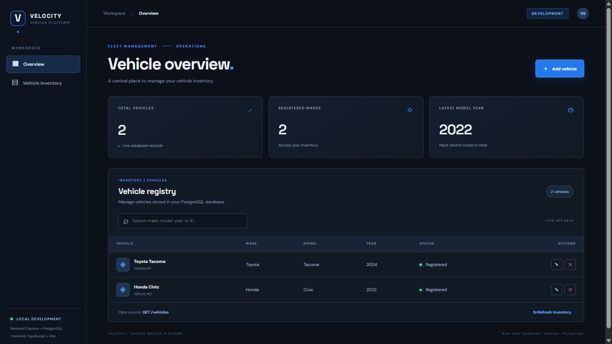

# Vehicle Service Platform

A full-stack vehicle management application built with TypeScript, Node.js, Express, PostgreSQL, and a Vite-powered frontend.

Users can view, add, edit, and delete vehicles through an interactive dashboard. Vehicle records are stored in PostgreSQL and persist across application restarts.

This project demonstrates practical software engineering concepts including RESTful API development, layered architecture, database integration, frontend/backend communication, and version control.

## Application Preview



The dashboard provides an interactive interface for managing vehicle records without manually sending API requests.

**Project status:** Working locally. Public deployment is planned.

## Current Status

**Completed: Full-stack application with PostgreSQL persistence.**

Implemented functionality includes:

- TypeScript-based Node.js and Express backend
- Modular application structure
- RESTful vehicle API
- Controller and service layers
- PostgreSQL database integration
- Persistent vehicle records
- Database application role and permissions
- Environment-based database configuration
- Interactive TypeScript frontend
- Vehicle creation, retrieval, updating, and deletion
- Health-check endpoint
- HTTP status handling
- Successful backend and frontend production builds
- Manual API testing with Postman
- Frontend CRUD functionality verified

Additional validation, automated testing, and deployment infrastructure are planned.

## Technology Stack

| Category | Technologies |
|---|---|
| Frontend | TypeScript, HTML, CSS, Vite |
| Backend | Node.js, TypeScript, Express |
| Database | PostgreSQL |
| API | REST, JSON, HTTP |
| Testing | Postman (manual testing) |
| Development | npm, Git, GitHub |
| Planned | Docker, GitHub Actions, Cloud Deployment |

## Architecture

The application follows a layered architecture:

```text
                  User
                   |
                   v
           Frontend Dashboard
                   |
                   v
             Express REST API
                   |
                   v
                 Router
                   |
                   v
               Controller
                   |
                   v
                Service
                   |
                   v
              PostgreSQL
```

Each layer has a separate responsibility:

- **Frontend:** Displays vehicle records and provides controls for managing them.
- **Express application:** Configures the backend and registers API routes.
- **Router:** Maps HTTP methods and paths to controller functions.
- **Controller:** Processes requests and returns HTTP responses.
- **Service:** Performs vehicle-related operations and interacts with the database.
- **Database:** Stores vehicle information persistently.

## Features

### Vehicle Management

Users can:

- View all vehicles
- Retrieve an individual vehicle by ID through the API
- Add a vehicle
- Update an existing vehicle
- Delete a vehicle
- Refresh the dashboard to retrieve current records

### PostgreSQL Persistence

Vehicle records are stored in PostgreSQL rather than temporary application memory.

Records remain available after the backend server restarts.

### Interactive Dashboard

The frontend provides a dark-themed vehicle management interface connected to the Express API.

## API Endpoints

### General

| Method | Endpoint | Description |
|---|---|---|
| GET | `/` | Confirm the API is running |
| GET | `/health` | Retrieve service health information |

### Vehicles

| Method | Endpoint | Description |
|---|---|---|
| GET | `/vehicles` | Retrieve all vehicles |
| GET | `/vehicles/:id` | Retrieve a vehicle by ID |
| POST | `/vehicles` | Create a vehicle |
| PUT | `/vehicles/:id` | Update a vehicle |
| DELETE | `/vehicles/:id` | Delete a vehicle |

## Example Vehicle

```json
{
  "id": 1,
  "make": "Toyota",
  "model": "Tacoma",
  "year": 2004
}
```

## Example Request

Create a vehicle:

```http
POST /vehicles
Content-Type: application/json
```

```json
{
  "make": "Ford",
  "model": "Mustang",
  "year": 2025
}
```

Example successful response:

```json
{
  "id": 3,
  "make": "Ford",
  "model": "Mustang",
  "year": 2025
}
```

The vehicle ID is generated by PostgreSQL and depends on existing database records.

## HTTP Responses

The API currently uses status codes including:

- `200 OK` — successful retrieval, update, or deletion
- `201 Created` — vehicle successfully created
- `400 Bad Request` — invalid vehicle ID
- `404 Not Found` — requested vehicle does not exist

Comprehensive request-body validation and standardized error handling are planned for Phase 4.

## Project Structure

```text
vehicle-service-platform/
|
|-- database/
|   |-- schema.sql
|   |-- permissions.sql
|   |-- README.md
|   `-- VALIDATION_NOTES.md
|
|-- docs/
|   `-- screenshots/
|       `-- dashboard-overview.jpg
|
|-- frontend/
|   |-- src/
|   |   |-- api.ts
|   |   |-- main.ts
|   |   `-- styles.css
|   |-- index.html
|   |-- package.json
|   `-- vite.config.ts
|
|-- src/
|   |-- config/
|   |   `-- database.ts
|   |-- controllers/
|   |   `-- vehicleController.ts
|   |-- routes/
|   |   |-- healthRoutes.ts
|   |   `-- vehicleRoutes.ts
|   |-- services/
|   |   `-- vehicleService.ts
|   |-- app.ts
|   `-- server.ts
|
|-- .env.example
|-- package.json
|-- package-lock.json
|-- tsconfig.json
`-- README.md
```

## Running the Project Locally

### Prerequisites

- Node.js and npm
- PostgreSQL
- Git

### 1. Clone the Repository

```bash
git clone https://github.com/Angelo-Baca/vehicle-service-platform.git
cd vehicle-service-platform
```

### 2. Install Backend Dependencies

```bash
npm install
```

### 3. Configure PostgreSQL

Create the database, initialize the schema, and configure the application role.

Follow the [PostgreSQL Setup Instructions](database/README.md).

Create a local `.env` file using `.env.example` as a reference.

Never commit database credentials to Git.

### 4. Start the Backend

```bash
npm run dev
```

The API runs locally at:

`http://localhost:3000`

### 5. Install Frontend Dependencies

Open a second terminal:

```bash
cd frontend
npm install
```

### 6. Start the Frontend

```bash
npm run dev
```

Open the local address displayed by Vite, normally:

`http://localhost:5173`

The frontend communicates with the backend running on port 3000.

### Production Builds

Backend:

```bash
npm run build
```

Frontend